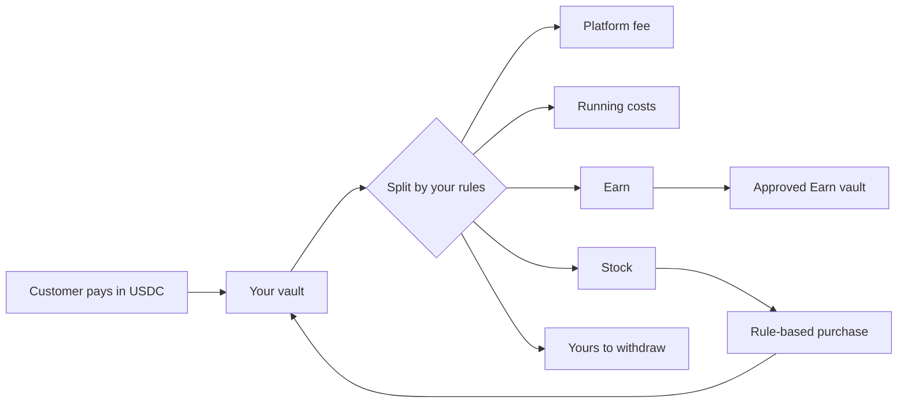

- **Your vault** is your own smart contract. It holds your USDC and stock.
- **Your agents** are services you create from templates. People pay them in USDC.
- **The worker** is an automatic helper that acts only within your rules.
- **The report** records every movement.

## The journey of a payment

<Steps>
  <Step title="A payment arrives">
    A customer pays your agent, or sends USDC to your pay link.
  </Step>
  <Step title="The vault splits it">
    Five parts that add up to exactly 100%, usually within a few minutes.
  </Step>
  <Step title="Stocks are bought">
    Your agent spends only the stock part, only on your stocks, within your limits.
  </Step>
  <Step title="Earn is lent">
    The Earn part goes into an approved vault. Yield varies and is not guaranteed.
  </Step>
</Steps>

## Who can do what

| Action | You | Your agent | OwnFlow |
|---|---|---|---|
| Withdraw or sell | Yes | No | No |
| Change your split or stocks | Yes | No | No |
| Split a payment | Yes (anyone can) | Yes | No |
| Buy a stock inside your rules | No | Yes | No |
| Lend into the approved Earn vault | No | Yes | No |
| Bill running costs, within limits | No | Yes | No |
| Stop automatic actions in an emergency | No | No | Yes |

OwnFlow can stop automatic actions, but it can never stop **you** from taking your money out.

## When something cannot happen

OwnFlow **fails safe**. If a stock is unavailable, a price looks wrong or a trade fails, nothing is spent. The money stays in USDC, **Activity** shows the reason, and your agent waits an hour before it tries that stock again.

## Reports

**Report** says **Balanced** or **Mismatch**. It checks that everything received equals the fee, running costs, stock, Earn and yours to withdraw. For your whole history it also compares the records with the blockchain.

Choose a period and click **Export CSV** for your records. A report is not tax or accounting advice.

The contracts behind all of this are on [Contracts](/resources/networks-and-contracts).
