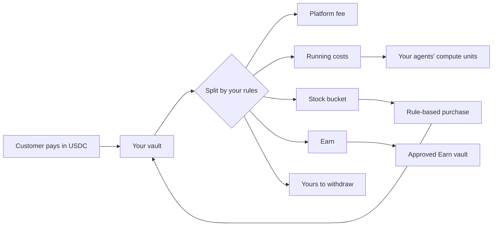

OwnFlow has four parts that work together:

- **Your vault:** your own smart contract that holds your USDC and stock. Only you can take money out.
- **Your agents:** services you create from templates. People pay them in USDC.
- **The worker:** an automatic helper that splits payments, buys stock and lends your Earn share, only within your rules.
- **The report:** a record of every movement that must balance to the last unit.

## The journey of a payment

<Steps>
  <Step title="A payment arrives">
    A customer calls your agent and pays in USDC, or sends USDC to your pay link. The money goes to your vault.
  </Step>
  <Step title="The vault splits it">
    The vault divides it into five parts that add up to exactly 100%. This usually happens within a few minutes.
  </Step>
  <Step title="Stocks are bought">
    Your agent spends only the stock bucket, only on stocks you approved, never past your maximum weight or daily limit.
  </Step>
  <Step title="Earn is lent">
    The Earn share is lent into an approved vault. Yield varies and is not guaranteed.
  </Step>
  <Step title="Everything is recorded">
    Each movement is an event on the blockchain. Your report checks that everything adds up.
  </Step>
</Steps>

## When something cannot happen

OwnFlow **fails safe**. If a market is closed, a stock is paused, a price looks wrong or a swap fails:

- nothing is spent,
- the money stays in USDC,
- the reason appears in your **Activity**,
- your agent waits an hour before it tries that stock again.

## Who can do what

| Action | You | Your agent | OwnFlow |
|---|---|---|---|
| Withdraw money or stock | Yes | No | No |
| Sell stock | Yes | No | No |
| Change your split or stock list | Yes | No | No |
| Split a payment | Yes (anyone can) | Yes | No |
| Buy a stock inside your rules | No | Yes | No |
| Lend your Earn share into an approved vault | No | Yes | No |
| Bill your agents' compute units, within limits | No | Yes | No |
| Stop all agents' actions in an emergency | No | No | Yes, only stop |

OwnFlow can stop agent actions in an emergency, but it can never stop **you** from taking your money out.
