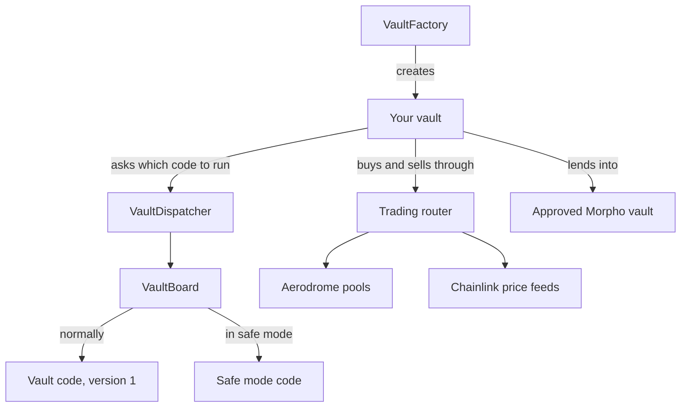

OwnFlow runs on **Base** (chain ID 8453).

<Warning>
  **Never send money to a contract on this page.** Payments go to **your own vault**. Your address is shown in the app and on your pay page. USDC sent to one of these contracts can be lost.
</Warning>

## How the contracts fit together

## OwnFlow's contracts

The source code of each one is verified on Basescan, so you can read it there.

| Contract | What it does | Address |
|---|---|---|
| VaultFactory | Creates vaults. Keeps the approved Earn vaults and routers, the defaults for new vaults and the emergency stop. | [`0xeaBDa559b8011E4AD242D9219d7C72716bAE9262`](https://basescan.org/address/0xeaBDa559b8011E4AD242D9219d7C72716bAE9262) |
| VaultBoard | Decides which vault code every vault runs. Enforces the waiting period and safe mode. | [`0x75d5316A1C32C8e4D35287386693C97ADa951608`](https://basescan.org/address/0x75d5316A1C32C8e4D35287386693C97ADa951608) |
| VaultDispatcher | The small piece each vault points to. It asks the board for the code and runs it with your vault's money and settings. | [`0xe3D0088953628a70688fa4c1611CDf0F380b03F6`](https://basescan.org/address/0xe3D0088953628a70688fa4c1611CDf0F380b03F6) |
| Vault code, version 1 | The rules of a vault: split, purchase, Earn, running costs and your own actions. | [`0xD00ADe7399dab86CfADfb0107E28e9c4E55eAA32`](https://basescan.org/address/0xD00ADe7399dab86CfADfb0107E28e9c4E55eAA32) |
| Safe mode code | Your own actions only. Nothing automatic. | [`0x9F3f31cf542605830815dFa5F727AEC6ba54fbFc`](https://basescan.org/address/0x9F3f31cf542605830815dFa5F727AEC6ba54fbFc) |
| Trading router | Checks every purchase and sale against a reference price and trades on the pool. | [`0xFeBc7fFDa459B4fF8D8F77e90696B95bE5E167c6`](https://basescan.org/address/0xFeBc7fFDa459B4fF8D8F77e90696B95bE5E167c6) |
| Forwarder | Carries the actions you sign, so you do not need gas. | [`0x3F54aA87be4BBC51B65406b93C09cFB1bD866d46`](https://basescan.org/address/0x3F54aA87be4BBC51B65406b93C09cFB1bD866d46) |

Your vault has its own address. It is not in this list.

## What OwnFlow is built on

These contracts are not OwnFlow's. OwnFlow depends on them.

| Contract | Run by | Used for | Address |
|---|---|---|---|
| USDC | Circle | All payments and balances | [`0x833589fCD6eDb6E08f4c7C32D4f71b54bdA02913`](https://basescan.org/address/0x833589fCD6eDb6E08f4c7C32D4f71b54bdA02913) |
| Swap router | Aerodrome | Buying and selling stock tokens | [`0x9Ee35Bf1bd69a03c6F0393582030fCe8Bb93D418`](https://basescan.org/address/0x9Ee35Bf1bd69a03c6F0393582030fCe8Bb93D418) |
| Pool factory | Aerodrome | Finding each stock's trading pool | [`0x9CB220581b91b0C83223012FE69688b92aD07a76`](https://basescan.org/address/0x9CB220581b91b0C83223012FE69688b92aD07a76) |
| Sequencer uptime feed | Chainlink | Stopping trades while the Base sequencer is down | [`0xBCF85224fc0756B9Fa45aA7892530B47e10b6433`](https://basescan.org/address/0xBCF85224fc0756B9Fa45aA7892530B47e10b6433) |
| Gauntlet USDC Prime | A Morpho vault (its curator is shown on Morpho) | Earn | [`0x050cE30b927Da55177A4914EC73480238BAD56f0`](https://basescan.org/address/0x050cE30b927Da55177A4914EC73480238BAD56f0) |

Each stock also has a token contract and a Chainlink price feed. See [Supported stocks](/stocks/supported-stocks).

Agents are paid with [x402](https://www.x402.org). A payment service run by Coinbase checks and settles each payment.

## Current settings

| Setting | Value |
|---|---|
| Platform fee for a new vault | 1% of every split |
| Waiting period before new vault code can reach a vault | 3 days. This one cannot be changed. |
| How much worse than the reference price a trade may be | 2%, after the pool fee |
| Oldest price a trade accepts | 26 hours |

## Who controls these contracts

Today **one wallet** holds the owner and guardian roles of the factory, the board and the router. It is an ordinary wallet, not a multi-signature wallet. You can read it on Basescan with `owner()` and `guardian()`.

What that wallet can and cannot do is in [Control and safety](/safety/guarantees).

## Check that a vault is OwnFlow's

Open the VaultFactory on Basescan, choose **Read contract**, and call `isVault` with the vault's address. The answer is `true` for a vault the factory made.
